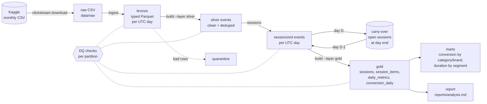
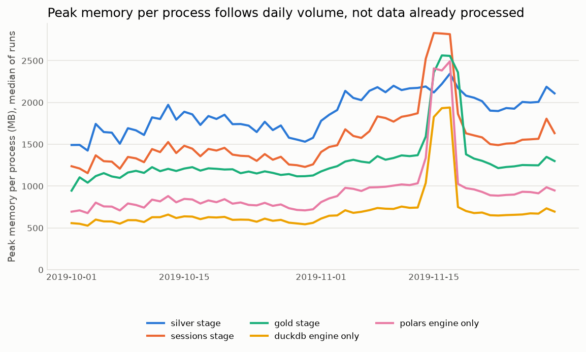

# Clickstream sessionization

A reproducible batch pipeline that turns raw e-commerce clickstream events into user sessions and
session-level analytics, with a sessionization whose correctness is checked rather than assumed.

It runs on a laptop: one month (42 million events) is the default run, and more months are
processed one UTC day at a time, so per-process memory depends on the size of a day rather than on
how much data has already been processed.

**What's here**

- Layers: raw CSV -> bronze (typed Parquet, partitioned by day) -> silver (cleaned, deduplicated,
  sessionized) -> gold (sessions, daily metrics, funnel, conversion and duration by segment).
- Three independent sessionizers (DuckDB SQL, Polars, plain Python) that must agree row for row.
  They agree on all 109,820,004 events of Oct-Nov 2019.
- Incremental, idempotent runs: re-running a day gives byte-identical files; adding a day doesn't
  touch earlier days; sessions that cross midnight are carried over explicitly.
- Data-quality checks at every layer that block publishing a partition when they fail.
- Tests on hand-made edge cases and a committed synthetic sample; CI runs without Kaggle.

All numbers below come from files in [`reports/`](reports/), produced by the scripts in this repo.

## Architecture



| Layer | Path | Contents |
|---|---|---|
| bronze | `data/bronze/events/event_date=D/<source>.parquet` | Every CSV row, typed, with `source_file` and `source_row` (lineage and a deterministic tie-breaker) |
| silver | `data/silver/events/event_date=D/` | Valid rows, exact duplicates removed, `category_top`, `is_zero_price` |
| | `data/silver/quarantine/event_date=D/` | Rows that broke a rule, with `quarantine_reason` |
| | `data/silver/user_day_flags/event_date=D/` | Suspected-bot user-days |
| | `data/silver/sessionized_events/event_date=D/` | Silver rows plus `session_id`, `session_start` |
| state | `data/state/carry/event_date=D/`, `manifest.json` | Sessions open at the end of D; input/output fingerprints |
| gold | `data/gold/{sessions,session_items,daily_metrics,conversion_daily}/session_date=D/` | Partitioned by the session's start date |
| | `data/gold/marts/*.parquet` | Users flagged by the sustained bot rule; conversion by category and brand; median/p90 duration by segment (all excluding suspected bots) |

Everything under `data/` except the synthetic sample is gitignored.

## Data

[eCommerce behavior data from multi category store](https://www.kaggle.com/datasets/mkechinov/ecommerce-behavior-data-from-multi-category-store),
thanks to [REES46 Marketing Platform](https://rees46.com/) (see [Dataset attribution](#dataset-attribution)).
Each row is one event: `event_time, event_type, product_id, category_id, category_code, brand, price, user_id, user_session`.
Kaggle hosts two months, October and November 2019.

From [`reports/profile_2019-10.txt`](reports/profile_2019-10.txt) and [`reports/profile_2019-11.txt`](reports/profile_2019-11.txt):

| | Oct 2019 | Nov 2019 |
|---|---:|---:|
| Rows | 42,448,764 | 67,501,979 |
| Users | 3,022,290 | 3,696,117 |
| `view` / `cart` / `purchase` | 40,779,399 / 926,516 / 742,849 | 63,556,110 / 3,028,930 / 916,939 |
| `remove_from_cart` (documented, never present) | 0 | 0 |
| Exact duplicate rows (extra copies) | 30,220 (28,073 are `cart`) | 100,519 (98,912 are `cart`) |
| Rows out of time order in the file | 0 | 0 |
| Null `category_code` / `brand` | 13,515,609 / 6,113,008 | 21,898,171 / 9,218,235 |
| Zero / negative price | 68,673 / 0 | 188,088 / 0 |
| Gaps between a user's consecutive events that are <= 30 min | 87.89% | 88.62% |

There is no browser, OS or device column. All timestamps are UTC (the files say so); **daily
partitions and daily metrics use UTC days**. The store's local timezone isn't given, so "a day" here
is a UTC day, not the shoppers' calendar day.

## Session definition

**A session is a run of one user's events with no gap longer than 30 minutes.** An event exactly
30:00 after the previous one stays in the session; 30:01 starts a new one. A session belongs to the
UTC date of its first event.

Why 30 minutes:

- It's the common web-analytics convention, which makes the numbers comparable with other work.
  **That's the reason it was chosen.**
- The data is consistent with it but doesn't single it out. The gap distribution has no sharp elbow
  (`profile_*.txt`, 5-minute bins). Against the dataset's own `user_session` id, the share of sessions
  that match exactly is flat between about 20 and 60 minutes:

  | N (min) | Oct: sessions | Oct: exact match | Nov: sessions | Nov: exact match |
  |---:|---:|---:|---:|---:|
  | 5 | 9,325,160 | 71.756% | 13,653,441 | 68.279% |
  | 10 | 8,416,955 | 79.470% | 12,079,112 | 76.764% |
  | 15 | 8,131,654 | 80.959% | 11,568,958 | 78.510% |
  | 20 | 7,979,108 | 81.418% | 11,291,691 | 79.075% |
  | **30** | **7,796,425** | **81.708%** | **10,959,754** | **79.435%** |
  | 45 | 7,634,886 | 81.726% | 10,663,724 | 79.485% |
  | 60 | 7,524,798 | 81.605% | 10,463,167 | 79.344% |
  | 120 | 7,250,379 | 80.810% | 9,967,015 | 78.360% |

  30 and 60 minutes differ by about 0.1 point (81.708% vs 81.605% in October, 79.435% vs 79.344%
  in November), and 45 minutes
  is marginally higher than 30 in both months. So the data supports anything from roughly 20 to 60
  minutes; 30 was picked by convention, not because the data prefers it. The full table and chart
  are in [`analysis.md`](reports/analysis.md#sensitivity-to-the-inactivity-threshold-n) (computed on
  silver events; November counts include sessions continuing from Oct 31).

The dataset's `user_session` isn't an inactivity rule, so it can't serve as ground truth: it changes
between events seconds apart (371,562 times in October after a gap under one minute) and stays the
same across gaps of more than a day (18,569 times). See
[How these sessions differ from `user_session`](#how-these-sessions-differ-from-user_session).

### Midnight, file boundaries, out-of-order and late events

- **Midnight and day partitions.** Each day is sessionized with the previous day's *carry-over*: the
  sessions whose last event is within 30 minutes of midnight, i.e. the only ones that can still be
  extended. A session can run across several days: a synthetic test user spans three; in the real
  data the longest sessions span two UTC days.
- **File boundaries.** Partitions are by event date, not by source file, so Oct 31 -> Nov 1 is handled
  like any other midnight. Two source files can write to the same day (one Parquet file each).
- **Out of order within a day.** Each day is sorted by `(user_id, event_time, source_file, source_row)`
  before sessionizing. The real files have no out-of-order rows; the tests do.
- **Same-second ties** don't change session boundaries; `source_row` only makes row order deterministic.
- **Late data** (a new file with events for a day already processed): the day's input fingerprint
  changes, so that day is rebuilt, then each following day whose carry-over input changed. The
  cascade stops at the first day whose carry-over is unchanged (`test_late_data_reprocesses_only_affected_days`).

## Verifying correctness

1. **Three implementations, one contract** (`src/clickstream/sessionize/`): DuckDB SQL (`lag` + a
   running `sum` of new-session flags), Polars (`diff().over(user)` + `cum_sum`), and a plain-Python
   streaming reference that uses only the standard library (one small state record per user, events in
   time order). Same input -> same `session_id` per row and the same carry-over. Session ids are
   `<user_id>-<start epoch seconds>`, so they don't depend on the engine or the run.
2. **Agreement on real data** (`clickstream compare-engines`; each engine chains its *own* carry-over
   from day to day, so a divergence would propagate rather than be masked):

   | Comparison | Events | Sessions started | Mismatching rows | Source |
   |---|---:|---:|---:|---|
   | DuckDB vs Polars, all 61 days of Oct-Nov 2019 | 109,820,004 | 18,756,054 | 0 | [`engine_agreement_duckdb_polars.json`](reports/engine_agreement_duckdb_polars.json) |
   | DuckDB vs Polars vs Python, busiest day (2019-11-16) | 6,488,924 | 757,013 | 0 | [`engine_agreement_3engines_2019-11-16.json`](reports/engine_agreement_3engines_2019-11-16.json) |

   On that day the engines took 2.52 s (DuckDB), 3.37 s (Polars) and 37.05 s (Python) of compute.
3. **Invariants checked on every day before it is published**: every silver event gets exactly one
   session; no gap over 30 minutes inside a session; no session split without such a gap (including
   across midnight); a session's start is its first event; continued sessions come from the carry-over.
   Gold re-checks that each session starts at its first event, which fails if part of a session were
   lost across a day boundary.
4. **Tests** (`pytest`) on hand-made events, every one run against all three engines: gaps of exactly
   30:00 and 30:01, a single-event session, same-second ties, shuffled input, a session crossing
   midnight, the inclusive carry-over boundary (23:30:00 vs 23:29:59), one session spanning three day
   partitions, and agreement on generated random data. End-to-end tests on the committed sample cover
   duplicates, quarantine, the bot flag, a purchase without a cart, and a re-run with no changes.

## Incremental and idempotent runs

- **Idempotent.** Every stage writes a partition to a temporary directory and swaps it in with a
  rename. Output is sorted on a unique key and money is summed as `DECIMAL`, so a forced re-run
  produces byte-identical files (`test_forced_rerun_is_byte_identical`).
- **Skips unchanged work.** `data/state/manifest.json` stores each partition's input and output
  fingerprints. A stage skips a partition when both match; editing an input or deleting an output
  makes it rebuild. Bronze skips a CSV whose name, size and mtime are unchanged.
- **New days don't reprocess old ones.** Day D needs only silver(D) and carry(D-1). Gold for a start
  date S reads S plus later days only while carry-over shows S's sessions still open, so adding day D
  rebuilds gold for D and for the start dates of sessions carried into D (usually just D-1).
  `test_incremental_equals_full_run` checks that running days 1-2 and then 3-4 produces the same
  bytes as running all four at once, for each engine.

## Data quality

Checks run inside each stage, against the not-yet-published output. Each partition gets a JSON report
in `data/dq/<stage>/<partition>.json`.

| Stage | Errors (block publishing, exit code 2) | Warnings (logged, published) |
|---|---|---|
| bronze | header matches the schema; CSV rows = staged rows = bronze rows; timestamps parse strictly as `YYYY-MM-DD HH:MM:SS UTC` | |
| silver | bronze = silver + quarantined + duplicates removed; no null keys; no exact duplicates left; every event inside its day | quarantine rate > 0.1%; duplicate rate > 1%; unknown event types; day volume more than 50% off the trailing 7-day median |
| sessions | the session invariants listed above | |
| gold | session event counts reconcile; unique session ids; sessions start at their first event; non-negative durations | |
| `clickstream check` | totals reconcile across all layers; no partition's latest report failed | |

On failure the temporary output is discarded and the previous version of the partition stays in place
(`test_failed_check_does_not_publish`).

Silver rules: rows with a null key, an unknown event type, a negative price or a timestamp outside the
partition day go to quarantine. Exact duplicates over all 9 source columns are dropped, keeping the
first copy. Zero-price rows and null `user_session` are kept and flagged. Results for Oct-Nov, from
[`reports/analysis.md`](reports/analysis.md):

| Month | Exact duplicates removed | Purchase duplicates (revenue removed) | Quarantined | Zero-price rows kept | DQ warnings |
|---|---:|---:|---:|---:|---|
| 2019-10 | 30,220 (cart 28,073, view 2,071, purchase 76) | 76 (24,289.64) | 0 | 68,670 | none |
| 2019-11 | 100,519 (cart 98,912, view 1,598, purchase 9) | 9 (1,809.69) | 0 | 187,987 | daily volume on Nov 14-17 (a spike, up to 6,488,924 events on Nov 16) |

**Suspected bots.** Two rules, with thresholds in [`config.py`](src/clickstream/config.py). Flagged
rows are always kept; the segment marts and the report's non-bot figures exclude both rules.

- **Day rule** (per user and UTC day, applied incrementally in silver): at least 30 events in one
  calendar minute or at least 1,000 events in the day (`BOT_MAX_EVENTS_PER_MINUTE`,
  `BOT_MAX_EVENTS_PER_DAY`). Sessions touching a flagged user-day get `suspect_bot = true`.
- **Sustained rule** (per user and calendar month): active on at least 20 days, at least 100 events per
  active day, and no purchase that month (`BOT_SUSTAINED_MIN_ACTIVE_DAYS`,
  `BOT_SUSTAINED_MIN_EVENTS_PER_ACTIVE_DAY`, `BOT_SUSTAINED_MAX_PURCHASES`). It catches users like
  October's most active one (31 active days, 7,436 events, no purchases), whom the day rule misses.
  It needs a whole month, so it's applied in the marts (`gold/marts/bot_users_sustained.parquet`) and
  the report, not in the per-day `daily_metrics` table, whose `non_bot` rows exclude the day rule only.
  The 100 events/day bar sits at the top of real buyers: among users with 20+ active days and at least
  one purchase, the most active averaged 103.1 events per active day in October and 142.3 in November.

| Month | Rule | Users flagged | Events | Share of events | Sessions |
|---|---|---:|---:|---:|---:|
| 2019-10 | day rule | 7 | 2,869 | 0.007% | 16 |
| 2019-10 | sustained rule | 2 | 11,449 | 0.027% | 441 |
| 2019-10 | either | 9 | 14,318 | 0.034% | 457 |
| 2019-11 | day rule | 37 | 47,320 | 0.070% | 162 |
| 2019-11 | sustained rule | 8 | 43,056 | 0.064% | 1,095 |
| 2019-11 | either | 43 | 84,323 | 0.125% | 1,246 |

Events are those on flagged user-days (day rule) or all of the user's events that month (sustained rule).

## Results

From [`reports/analysis.md`](reports/analysis.md) (all sessions; non-bot numbers are there too):

| | Oct 2019 | Nov 2019 |
|---|---:|---:|
| Sessions | 7,796,425 | 10,959,629 |
| Median session duration, all / 2+ events | 96 s / 229 s | 110 s / 254 s |
| p90 session duration, all / 2+ events | 1,017 s / 1,327 s | 1,212 s / 1,541 s |
| Single-event sessions | 30.6% | 28.7% |
| View -> cart (sessions with a view that reach cart) | 6.73% | 13.86% |
| Cart -> purchase | 53.28% | 39.39% |
| Session conversion (any purchase) | 7.47% | 6.46% |
| Purchase sessions without a cart event | 52.0% | 15.5% |

The funnel counts sessions that *reached* each stage. A strict view -> cart -> purchase sequence would
drop many purchases: in October about half of the sessions with a purchase have no cart event at all.

**Duration by segment** (the link to the original take-home, below): median and p90 session duration
by the session's entry top-level category, entry brand and entry price band are in the gold mart
`duration_by_segment` and in `analysis.md`. For example, sessions entering on a product priced 1000+
have a median of 62 s, against 117 s for 100-250.

### How these sessions differ from `user_session`

| | Oct 2019 | Nov 2019 |
|---|---:|---:|
| My sessions (N = 30) | 7,796,425 | 10,959,754 |
| `user_session` ids | 9,244,421 | 13,776,050 |
| Exact matches (same events) | 6,370,341 (81.71%) | 8,705,896 (79.44%) |
| My sessions spanning 2+ `user_session` ids | 1,122,878 | 1,794,216 |
| `user_session` ids split across 2+ of my sessions | 156,606 | 250,917 |
| `user_session` ids shared by 2+ users | 348 | 591 |

Most differences are merges: the store often starts a new id after a short pause (in October,
371,562 id changes came after less than a minute), which a 30-minute rule keeps together. Splits go
the other way: the store keeps an id across long inactivity (18,569 times across more than a day in
October). Ids shared between users can never match a per-user session. Counts are over each month's
event partitions, so November includes sessions continuing from Oct 31 (slightly more than in
the Results table).

## How to run

Requires Python 3.12. From the repo root:

```bash
python3.12 -m venv .venv && source .venv/bin/activate
pip install -r requirements.lock        # exact pinned versions
pip install --no-deps -e .
```

**Download** (needs a Kaggle account). The Kaggle client reads credentials from `~/.kaggle/kaggle.json`
(or the newer `~/.kaggle/access_token`), or from `KAGGLE_USERNAME` / `KAGGLE_KEY`. Nothing is stored in
this repo.

```bash
clickstream download --month 2019-10      # data/raw/2019-Oct.csv
```

**Pipeline**

```bash
clickstream run --months 2019-10                  # default: download if missing, ingest, silver, sessions, gold, check
clickstream run --months 2019-10,2019-11          # more months: still processed one day at a time

# or stage by stage
clickstream ingest --month 2019-10
clickstream build --layer silver [--start 2019-10-01 --end 2019-10-07] [--force]
clickstream sessions [--engine duckdb|polars|python]
clickstream build --layer gold [--skip-marts]
clickstream check
clickstream compare-engines --engines duckdb,polars,python --start 2019-11-16 --end 2019-11-16
clickstream report                                 # reports/analysis.md + figures
```

`clickstream report` is a full recompute over every built month (15-20 minutes for Oct-Nov on this
laptop; the runtime is in the footer of `analysis.md`) and isn't part of the incremental pipeline.

Settings: `CLICKSTREAM_DATA` (data root, default `data`), `CLICKSTREAM_DUCKDB_MEMORY` (default `2GB`).
Session gap, bot thresholds, price bands and DQ thresholds are in [`config.py`](src/clickstream/config.py).

**Tests and the synthetic sample** (no Kaggle needed):

```bash
pytest
ruff check . && ruff format --check .
CLICKSTREAM_DATA=/tmp/cs clickstream run --file data/sample/events_sample.csv
python scripts/make_sample.py             # regenerates data/sample/events_sample.csv (deterministic)
```

`data/sample/events_sample.csv` is generated, not real data: random users plus hand-placed edge cases.

**Benchmark and profiles**

```bash
python scripts/benchmark.py --months 2019-10,2019-11   # fresh data root under data/bench
python scripts/profile_month.py --month 2019-10 > reports/profile_2019-10.txt
```

## Benchmark

From [`reports/benchmark.md`](reports/benchmark.md): three full runs (`scripts/benchmark.py --runs 3`)
on an Apple M5 MacBook Air (10 cores, 16 GB RAM, fanless), DuckDB memory limit 2 GB, other CPU-heavy
jobs stopped. Each stage of each day ran as its own process; peak memory is that process's peak RSS.
Values are **median [min-max] across the three runs**.

Run conditions (recorded in `benchmark.md`): runs 1 and 2 on AC power, run 3 on battery (the laptop
was unplugged during run 2 and its lid was briefly closed). Run 3's stage times fall
within the range of runs 1 and 2.

| Run | Time (s) | Peak memory (MB) |
|---|---:|---:|
| Default: `clickstream run --months 2019-10`, one process | 111.8 [67.6-113.7] | 2,600 [2,033-2,778] |

| Month | Stage | Days | Total time (s) | Median time per day (s) | Max peak (MB) |
|---|---|---:|---:|---:|---:|
| 2019-10 | ingest | 1 | 17.1 [15.9-18.3] | | 1,445 [1,426-1,458] |
| 2019-10 | silver | 31 | 38.4 [36.4-40.7] | 1.28 [1.19-1.33] | 1,972 [1,967-1,978] |
| 2019-10 | sessions | 31 | 40.7 [37.1-44.2] | 1.33 [1.20-1.41] | 1,527 [1,510-1,528] |
| 2019-10 | gold | 31 | 56.0 [52.2-59.0] | 1.84 [1.70-1.91] | 1,232 [1,230-1,242] |
| 2019-11 | ingest | 1 | 28.9 [27.0-29.1] | | 2,596 [2,408-2,620] |
| 2019-11 | silver | 30 | 69.9 [69.4-82.6] | 1.63 [1.58-1.65] | 2,344 [2,222-2,527] |
| 2019-11 | sessions | 30 | 60.8 [57.6-65.9] | 1.64 [1.51-1.67] | 2,831 [2,824-3,118] |
| 2019-11 | gold | 30 | 75.5 [71.1-77.5] | 2.07 [2.03-2.22] | 2,563 [2,536-2,615] |
| both | marts | | 10.6 [10.3-10.7] | | 1,440 [1,418-1,568] |

Sessionization engines alone, per day, same inputs:

| Month | Engine | Total time (s) | Median time per day (s) | Max peak (MB) |
|---|---|---:|---:|---:|
| 2019-10 | DuckDB | 18.1 [17.1-19.1] | 0.58 [0.55-0.61] | 660 [656-667] |
| 2019-10 | Polars | 24.4 [22.6-25.5] | 0.79 [0.72-0.82] | 881 [880-889] |
| 2019-11 | DuckDB | 25.0 [22.0-26.0] | 0.68 [0.65-0.71] | 1,940 [1,888-1,988] |
| 2019-11 | Polars | 31.7 [29.5-32.7] | 0.92 [0.90-0.97] | 2,492 [2,482-2,496] |



Peak memory follows the size of each day, not the amount processed so far: it rises with
November's larger days and the mid-November spike, then falls back. Nov 15-17 are each over
6 million events, about three times the trailing median (DQ warnings in `analysis.md`), and they are
also the slowest days.

**Timings vary on this fanless laptop.** Per-stage totals stay within about 20% across runs, but the
default one-month run took 67.6 s when it started on a cool machine (run 1) and 111.8-113.7 s when it
started right after a full run (runs 2 and 3). An earlier single benchmark, run while other CPU-heavy
jobs were active, was slower still; it was replaced by these three runs.

## Limitations

- **Two months only.** Kaggle hosts Oct and Nov 2019. The dataset page links Dec 2019 - Apr 2020 on
  REES46's own server; `download.py` has a `DataSource` interface for adding that, but it isn't
  implemented.
- **Timings are from three runs on one fanless laptop**, and the default run varies a lot between a
  cool and a warm machine (see Benchmark). Memory figures are the more stable result.
- **Global steps aren't incremental.** The marts and `clickstream report` recompute over all data.
- **UTC days.** The store's timezone isn't published, so day boundaries and daily metrics are UTC.
- **No device data.** The original take-home's browser/OS/device breakdown can't be reproduced; entry
  category, brand and price band stand in for it.
- **Bot detection is heuristic.** Two threshold rules (bursts within a day, and sustained heavy
  activity without purchases over a month) flag 9 users in October and 43 in November. Bots that
  browse slowly, or that buy, aren't caught. The sustained rule only works on complete months: with
  fewer than 20 days of a month ingested, nobody can reach the active-days threshold. Flags are for
  analysis, not filters.
- **Exact duplicates are dropped.** Some may be genuine double clicks; they're counted per event type
  so the effect is visible.
- **Late data reprocessing** rebuilds the late day plus each following day whose carry-over
  changes; late data spread over many days would reprocess everything after the earliest one.
- **The funnel changes between months** (52.0% of October purchase sessions have no cart event, 15.5%
  in November). This looks like a change in how cart events were tracked; it isn't investigated here.
- **Revenue** is the sum of `price` over purchase events; there's no quantity field.

## Repository layout

```
src/clickstream/
  cli.py            command-line entry point (`clickstream ...`)
  config.py         session gap, bot thresholds, price bands, DQ thresholds, paths
  download.py       Kaggle download behind a swappable DataSource
  bronze.py silver.py sessions.py gold.py   the layers
  sessionize/       duckdb_impl.py, polars_impl.py, reference.py (stdlib only)
  quality.py check.py compare.py state.py io.py report.py charts.py
scripts/            make_sample.py, profile_month.py, benchmark.py
tests/              pytest suite
data/sample/        synthetic sample (the only committed data)
reports/            profiles, engine agreement, benchmark, analysis.md, figures/
```

## Dataset attribution

This project uses the
[eCommerce behavior data from multi category store](https://www.kaggle.com/datasets/mkechinov/ecommerce-behavior-data-from-multi-category-store)
dataset on Kaggle. Thanks to [REES46 Marketing Platform](https://rees46.com/) for the data, collected
by the Open CDP project. The dataset page allows free use when the source is credited with links to
the dataset page and to REES46. No raw or derived data from it is committed here; see [`NOTICE`](NOTICE).

## License

The code is under the [MIT License](LICENSE). The dataset is not part of this repository and has its
own terms; see [`NOTICE`](NOTICE).

## Origin

This project replaces a 2020 data-engineering take-home (`rodferro/dataplatform`, a private
repository) whose dataset is no longer available. That solution was written in plain Python with
only the standard library. The test asked for session metrics by browser, OS and device, which this
dataset doesn't have, so the gold table `duration_by_segment` uses entry category, brand and price
band instead. It also asked candidates to show their knowledge rather than their tools, which is what
the standard-library reference sessionizer (`sessionize/reference.py`) is here for. No code was
carried over from the original.
