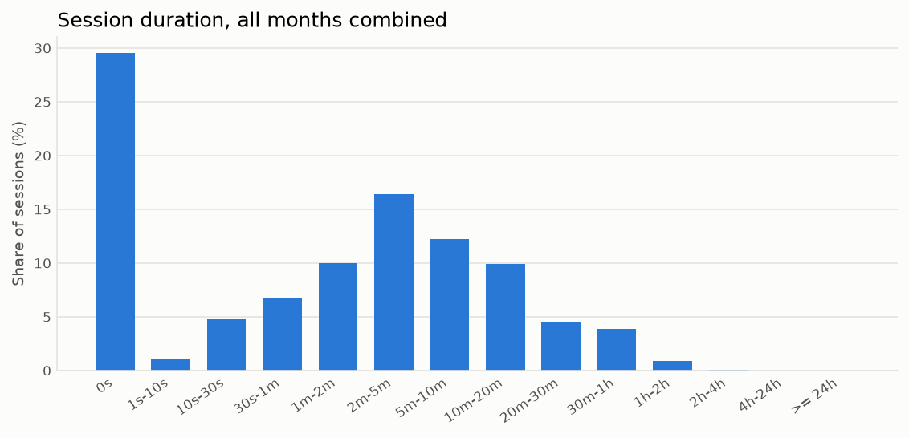
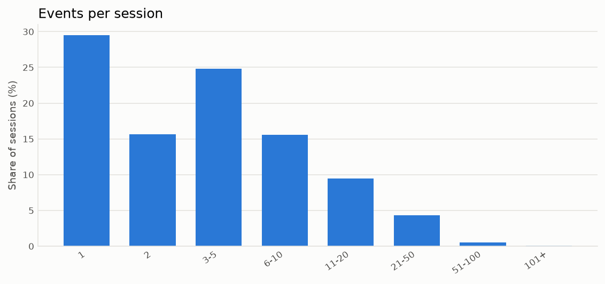
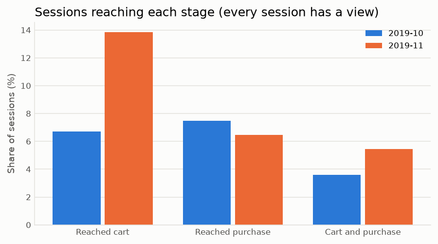
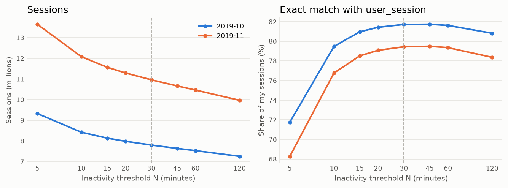

# Analysis

Generated by `clickstream report` from the gold tables, silver DQ reports and sessionized events. Months: 2019-10, 2019-11. Session = a user's events with no gap over 30 min. Sessions are assigned to the UTC date of their first event. Unless stated, figures include suspected bots.

## Overview

| Month | Events in these sessions | Users | Sessions starting in month | Sessions, non-bot | Revenue (sum of purchase prices) |
| --- | ---: | ---: | ---: | ---: | ---: |
| 2019-10 | 42,419,630 | 3,022,290 | 7,796,425 | 7,796,409 | 229,938,553 |
| 2019-11 | 67,400,374 | 3,696,097 | 10,959,629 | 10,959,467 | 275,187,741 |

## Data quality (silver)

| Month | Bronze rows | Exact duplicates removed | ...by event type | Purchase duplicates | Purchase duplicate revenue removed | Quarantined | Zero-price rows (kept, flagged) | Null user_session (kept) | Silver rows |
| --- | ---: | ---: | ---: | ---: | ---: | ---: | ---: | ---: | ---: |
| 2019-10 | 42,448,764 | 30,220 | cart 28,073, purchase 76, view 2,071 | 76 | 24,289.64 | 0 | 68,670 | 2 | 42,418,544 |
| 2019-11 | 67,501,979 | 100,519 | cart 98,912, purchase 9, view 1,598 | 9 | 1,809.69 | 0 | 187,987 | 10 | 67,401,460 |

Warnings across all partitions: 4. 2019-11-14 daily_volume_vs_trailing_median: {'rows': 3064736, 'trailing_median': 1938354}; 2019-11-15 daily_volume_vs_trailing_median: {'rows': 6205340, 'trailing_median': 1985382}; 2019-11-16 daily_volume_vs_trailing_median: {'rows': 6488924, 'trailing_median': 2006897}; 2019-11-17 daily_volume_vs_trailing_median: {'rows': 6379921, 'trailing_median': 2016711}

### Suspected bots

A user-day is flagged when the user has >= 30 events in one calendar minute or >= 1000 events in the UTC day (`config.py`). Flagged rows are kept; a session is `suspect_bot` if it touches a flagged user-day. Segment/conversion marts exclude them.

| Month | Users flagged | Share of users | User-days flagged | Events on flagged user-days | Share of events | Sessions flagged | Share of sessions |
| --- | ---: | ---: | ---: | ---: | ---: | ---: | ---: |
| 2019-10 | 7 | 0.000% | 7 | 2,869 | 0.01% | 16 | 0.000% |
| 2019-11 | 37 | 0.001% | 52 | 47,320 | 0.07% | 162 | 0.001% |

## Session length

Duration = last event time - first event time, in seconds. A single-event session has duration 0, so quantiles are given for all sessions and for sessions with 2+ events.

| Month | Population | Sessions | Single-event | p25 (s) | p50 (s) | p75 (s) | p90 (s) | p99 (s) | Max (s) |
| --- | ---: | ---: | ---: | ---: | ---: | ---: | ---: | ---: | ---: |
| 2019-10 | all | 7,796,425 | 30.6% | 0 | 96 | 387 | 1,017 | 3,160 | 34,527 |
| 2019-10 | 2+ events |  |  | 84 | 229 | 606 | 1,327 | 3,571 |  |
| 2019-11 | all | 10,959,629 | 28.7% | 0 | 110 | 457 | 1,212 | 3,789 | 43,744 |
| 2019-11 | 2+ events |  |  | 88 | 254 | 700 | 1,541 | 4,268 |  |

| Duration | Sessions | Share |
| --- | ---: | ---: |
| 0s | 5,542,630 | 29.6% |
| 1s-10s | 212,333 | 1.1% |
| 10s-30s | 887,801 | 4.7% |
| 30s-1m | 1,275,559 | 6.8% |
| 1m-2m | 1,872,613 | 10.0% |
| 2m-5m | 3,073,777 | 16.4% |
| 5m-10m | 2,296,881 | 12.2% |
| 10m-20m | 1,857,168 | 9.9% |
| 20m-30m | 834,010 | 4.4% |
| 30m-1h | 724,163 | 3.9% |
| 1h-2h | 161,483 | 0.9% |
| 2h-4h | 16,867 | 0.1% |
| 4h-24h | 769 | 0.0% |
| >= 24h | 0 | 0.0% |

## Events per session

Median 3, p90 14, p99 43, mean 5.86, max 4,128.

| Events | Sessions | Share |
| --- | ---: | ---: |
| 1 | 5,532,975 | 29.5% |
| 2 | 2,932,470 | 15.6% |
| 3-5 | 4,659,429 | 24.8% |
| 6-10 | 2,926,208 | 15.6% |
| 11-20 | 1,774,843 | 9.5% |
| 21-50 | 808,787 | 4.3% |
| 51-100 | 105,494 | 0.6% |
| 101+ | 15,848 | 0.1% |

## Funnel: view -> cart -> purchase

Counted as sessions that *reached* each stage, in any order. A strict view -> cart -> purchase sequence would undercount: many purchases have no cart event in the same session (last column).

| Month | Population | Sessions | With view | With cart | With purchase | View -> cart | Cart -> purchase | Session conversion | Purchase sessions without a cart |
| --- | ---: | ---: | ---: | ---: | ---: | ---: | ---: | ---: | ---: |
| 2019-10 | all | 7,796,425 | 7,794,728 | 524,302 | 582,529 | 6.73% | 53.28% | 7.47% | 52.0% |
| 2019-10 | non_bot | 7,796,409 | 7,794,712 | 524,297 | 582,525 | 6.73% | 53.28% | 7.47% | 52.0% |
| 2019-11 | all | 10,959,629 | 10,952,737 | 1,518,556 | 707,959 | 13.86% | 39.39% | 6.46% | 15.5% |
| 2019-11 | non_bot | 10,959,467 | 10,952,575 | 1,518,521 | 707,949 | 13.86% | 39.39% | 6.46% | 15.5% |

## Conversion and session duration by segment

From the gold marts (non-bot sessions). Conversion: of sessions with any event in the segment, the share that carted / purchased in it. Duration segments use the session's *entry* event (first product seen): top-level category, brand, and price band of that product. The original 2020 take-home asked for duration by browser / OS / device; this dataset has no device fields, so these segments stand in for them.

### Conversion by top-level category

| Category | Sessions | Carted | Purchased | Cart rate | Purchase rate | Revenue |
| --- | ---: | ---: | ---: | ---: | ---: | ---: |
| electronics | 8,739,289 | 1,160,013 | 716,789 | 13.27% | 8.20% | 381,689,526 |
| unknown | 7,307,862 | 519,996 | 343,006 | 7.12% | 4.69% | 52,800,468 |
| appliances | 2,350,560 | 240,362 | 148,006 | 10.23% | 6.30% | 32,221,765 |
| computers | 1,168,583 | 83,310 | 51,086 | 7.13% | 4.37% | 25,372,202 |
| apparel | 985,312 | 31,341 | 18,928 | 3.18% | 1.92% | 1,805,963 |
| furniture | 769,197 | 26,252 | 17,055 | 3.41% | 2.22% | 4,216,494 |
| auto | 509,694 | 28,406 | 19,031 | 5.57% | 3.73% | 2,648,961 |
| construction | 376,449 | 25,723 | 14,518 | 6.83% | 3.86% | 2,013,386 |
| kids | 350,853 | 14,004 | 10,129 | 3.99% | 2.89% | 1,401,904 |
| accessories | 160,268 | 5,131 | 3,386 | 3.20% | 2.11% | 166,987 |
| sport | 118,483 | 4,227 | 2,390 | 3.57% | 2.02% | 718,252 |
| country_yard | 10,340 | 246 | 128 | 2.38% | 1.24% | 28,143 |
| medicine | 10,019 | 1,058 | 613 | 10.56% | 6.12% | 29,943 |
| stationery | 7,188 | 470 | 250 | 6.54% | 3.48% | 5,240 |

### Conversion by brand (top 15 by sessions, brands with >= 1,000 sessions)

| Brand | Sessions | Carted | Purchased | Cart rate | Purchase rate | Revenue |
| --- | ---: | ---: | ---: | ---: | ---: | ---: |
| unknown | 4,240,150 | 167,920 | 113,387 | 3.96% | 2.67% | 19,565,435 |
| samsung | 3,838,441 | 484,134 | 303,420 | 12.61% | 7.90% | 101,270,890 |
| apple | 3,264,510 | 393,582 | 244,168 | 12.06% | 7.48% | 238,707,602 |
| xiaomi | 2,118,474 | 198,397 | 105,696 | 9.37% | 4.99% | 20,451,910 |
| huawei | 815,483 | 65,189 | 40,063 | 7.99% | 4.91% | 9,663,787 |
| lucente | 571,818 | 24,266 | 22,544 | 4.24% | 3.94% | 6,649,743 |
| lg | 537,814 | 36,016 | 18,886 | 6.70% | 3.51% | 8,626,380 |
| bosch | 497,489 | 22,802 | 12,275 | 4.58% | 2.47% | 3,081,447 |
| sony | 451,011 | 27,857 | 14,640 | 6.18% | 3.25% | 6,341,083 |
| cordiant | 449,865 | 38,082 | 24,534 | 8.47% | 5.45% | 1,304,972 |
| oppo | 433,530 | 36,735 | 22,184 | 8.47% | 5.12% | 5,900,575 |
| acer | 341,524 | 18,618 | 11,425 | 5.45% | 3.35% | 6,923,022 |
| respect | 334,848 | 10,808 | 5,874 | 3.23% | 1.75% | 526,240 |
| artel | 334,437 | 22,626 | 13,694 | 6.77% | 4.09% | 2,675,952 |
| lenovo | 295,655 | 14,656 | 9,744 | 4.96% | 3.30% | 4,450,745 |

### Session duration by entry top-level category

| Segment | Sessions | Median (s) | p90 (s) | Median, 2+ events (s) | p90, 2+ events (s) | Single-event |
| --- | ---: | ---: | ---: | ---: | ---: | ---: |
| electronics | 7,940,994 | 92 | 1,037 | 217 | 1,355 | 30.1% |
| unknown | 5,933,862 | 100 | 1,128 | 252 | 1,471 | 30.9% |
| appliances | 1,854,165 | 165 | 1,366 | 307 | 1,642 | 24.6% |
| computers | 923,730 | 115 | 1,265 | 248 | 1,573 | 26.8% |
| apparel | 675,493 | 114 | 1,134 | 259 | 1,457 | 29.2% |
| furniture | 467,771 | 139 | 1,302 | 291 | 1,611 | 27.0% |
| auto | 333,698 | 125 | 1,161 | 264 | 1,450 | 27.2% |
| kids | 238,072 | 52 | 1,029 | 239 | 1,476 | 38.4% |
| construction | 233,480 | 147 | 1,349 | 306 | 1,657 | 26.9% |
| accessories | 71,661 | 157 | 1,386 | 299 | 1,654 | 24.1% |
| sport | 68,920 | 100 | 1,111 | 239 | 1,436 | 29.8% |
| medicine | 6,205 | 111 | 1,070 | 228 | 1,345 | 26.8% |
| country_yard | 3,964 | 162 | 1,378 | 312 | 1,651 | 26.3% |
| stationery | 3,861 | 55 | 929 | 182 | 1,333 | 34.9% |

### Session duration by entry product price band

| Segment | Sessions | Median (s) | p90 (s) | Median, 2+ events (s) | p90, 2+ events (s) | Single-event |
| --- | ---: | ---: | ---: | ---: | ---: | ---: |
| 0-10 | 486,490 | 40 | 927 | 207 | 1,376 | 39.7% |
| 10-50 | 2,961,044 | 109 | 1,128 | 252 | 1,443 | 29.4% |
| 50-100 | 2,695,269 | 124 | 1,210 | 269 | 1,519 | 27.9% |
| 100-250 | 5,533,339 | 117 | 1,185 | 257 | 1,497 | 28.3% |
| 250-500 | 3,587,841 | 108 | 1,157 | 248 | 1,484 | 29.3% |
| 500-1000 | 2,332,580 | 88 | 1,029 | 208 | 1,352 | 30.0% |
| 1000+ | 1,159,313 | 62 | 840 | 176 | 1,194 | 34.6% |

### Session duration by entry brand (top 15 by sessions)

| Segment | Sessions | Median (s) | p90 (s) | Median, 2+ events (s) | p90, 2+ events (s) | Single-event |
| --- | ---: | ---: | ---: | ---: | ---: | ---: |
| samsung | 2,761,769 | 110 | 1,098 | 243 | 1,403 | 28.9% |
| apple | 2,625,141 | 65 | 826 | 172 | 1,156 | 33.2% |
| unknown | 2,334,666 | 109 | 1,187 | 267 | 1,531 | 30.2% |
| xiaomi | 1,363,203 | 97 | 1,126 | 226 | 1,436 | 28.9% |
| huawei | 407,320 | 102 | 1,122 | 240 | 1,436 | 29.5% |
| lucente | 319,993 | 142 | 1,305 | 298 | 1,627 | 27.5% |
| cordiant | 290,940 | 126 | 1,072 | 264 | 1,366 | 29.3% |
| lg | 239,281 | 159 | 1,365 | 298 | 1,646 | 24.8% |
| sony | 223,319 | 78 | 1,032 | 211 | 1,387 | 32.2% |
| oppo | 199,566 | 134 | 1,192 | 251 | 1,451 | 24.5% |
| bosch | 187,082 | 173 | 1,455 | 324 | 1,740 | 24.6% |
| acer | 177,333 | 152 | 1,314 | 265 | 1,564 | 22.6% |
| artel | 153,559 | 189 | 1,375 | 307 | 1,604 | 21.4% |
| respect | 142,504 | 160 | 1,335 | 304 | 1,624 | 25.1% |
| lenovo | 129,226 | 135 | 1,329 | 261 | 1,611 | 24.5% |

## How these sessions differ from the dataset's `user_session`

`user_session` is the store's own session id. It is not an inactivity rule: it changes between events seconds apart and stays the same across gaps of hours or days (see `reports/profile_*.txt`). Exact match = my session and a `user_session` id contain exactly the same events.

| Month | My sessions | user_session ids | Exact matches | Share of my sessions | My sessions spanning 2+ ids (merges) | ids split across 2+ of my sessions (splits) | ids shared by 2+ users |
| --- | ---: | ---: | ---: | ---: | ---: | ---: | ---: |
| 2019-10 | 7,796,425 | 9,244,421 | 6,370,341 | 81.71% | 1,122,878 | 156,606 | 348 |
| 2019-11 | 10,959,754 | 13,776,050 | 8,705,896 | 79.44% | 1,794,216 | 250,917 | 591 |

Counted over each month's event partitions, so a session that continues from the last day of the previous month is counted in both months (hence slightly more sessions than in the overview).

Why they differ: (1) the store starts a new id after very short gaps (merges on my side); (2) it keeps an id across long inactivity, up to days (splits on my side); (3) a few ids are shared by more than one user, which can never match a per-user session.

### Sensitivity to the inactivity threshold N

Sessions and exact-match share for other values of N (silver events). The pipeline uses N = 30.

| Month | N (min) | Sessions | Exact matches | Exact match share |
| --- | ---: | ---: | ---: | ---: |
| 2019-10 | 5 | 9,325,160 | 6,691,358 | 71.756% |
| 2019-10 | 10 | 8,416,955 | 6,688,944 | 79.470% |
| 2019-10 | 15 | 8,131,654 | 6,583,319 | 80.959% |
| 2019-10 | 20 | 7,979,108 | 6,496,416 | 81.418% |
| 2019-10 | 30 | 7,796,425 | 6,370,341 | 81.708% |
| 2019-10 | 45 | 7,634,886 | 6,239,709 | 81.726% |
| 2019-10 | 60 | 7,524,798 | 6,140,616 | 81.605% |
| 2019-10 | 120 | 7,250,379 | 5,859,061 | 80.810% |
| 2019-11 | 5 | 13,653,441 | 9,322,368 | 68.279% |
| 2019-11 | 10 | 12,079,112 | 9,272,459 | 76.764% |
| 2019-11 | 15 | 11,568,958 | 9,082,815 | 78.510% |
| 2019-11 | 20 | 11,291,691 | 8,928,890 | 79.075% |
| 2019-11 | 30 | 10,959,754 | 8,705,896 | 79.435% |
| 2019-11 | 45 | 10,663,724 | 8,476,042 | 79.485% |
| 2019-11 | 60 | 10,463,167 | 8,301,869 | 79.344% |
| 2019-11 | 120 | 9,967,015 | 7,810,121 | 78.360% |

_Report generated in 867 s._
