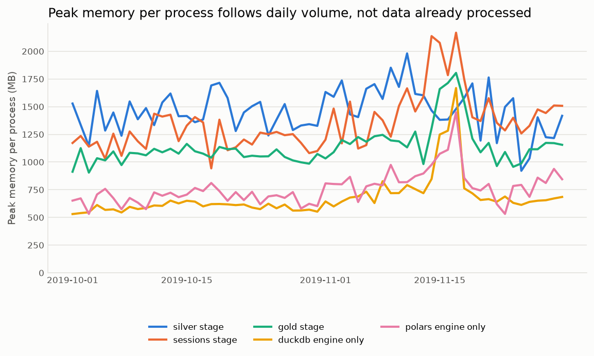

# Benchmark

Generated by `scripts/benchmark.py`. Machine: Apple M5, 10 cores, 16 GB RAM, macOS-27.2-arm64-arm-64bit; Python 3.12.16, DuckDB 2.0.0, Polars 2.1.0, DuckDB memory limit 2GB. Peak memory is the peak RSS of each child process.

## Default run (one month, single process)

| Command | Time (s) | Peak memory (MB) |
|---|---:|---:|
| `clickstream run --months 2019-10` | 184.3 | 1849 |

## Day by day, per stage and month

| Month | Stage | Runs | Total time (s) | Median time per run (s) | Max time per run (s) | Median peak (MB) | Max peak (MB) |
|---|---|---:|---:|---:|---:|---:|---:|
| 2019-10 | ingest | 1 | 34.0 | 33.97 | 33.97 | 976 | 976 |
| 2019-10 | silver | 31 | 85.5 | 2.60 | 4.70 | 1414 | 1715 |
| 2019-10 | sessions | 31 | 68.7 | 2.22 | 3.19 | 1203 | 1436 |
| 2019-10 | gold | 31 | 91.9 | 2.91 | 3.85 | 1073 | 1164 |
| 2019-11 | ingest | 1 | 71.2 | 71.20 | 71.20 | 2096 | 2096 |
| 2019-11 | silver | 30 | 185.4 | 4.05 | 30.97 | 1533 | 1981 |
| 2019-11 | sessions | 30 | 135.1 | 3.10 | 21.53 | 1455 | 2168 |
| 2019-11 | gold | 30 | 172.4 | 4.82 | 19.40 | 1173 | 1805 |
| all | marts | 1 | 8.9 | | | 389 | 389 |
| all | check | 1 | 0.8 | | | 160 | 160 |

## Sessionization engines (per day, compute only, same inputs)

| Month | Engine | Days | Total time (s) | Median time per day (s) | Median peak (MB) | Max peak (MB) |
|---|---|---:|---:|---:|---:|---:|
| 2019-10 | duckdb | 31 | 32.9 | 1.03 | 596 | 652 |
| 2019-10 | polars | 31 | 45.5 | 1.42 | 683 | 811 |
| 2019-11 | duckdb | 30 | 59.4 | 1.66 | 687 | 1668 |
| 2019-11 | polars | 30 | 93.2 | 2.08 | 809 | 1450 |

